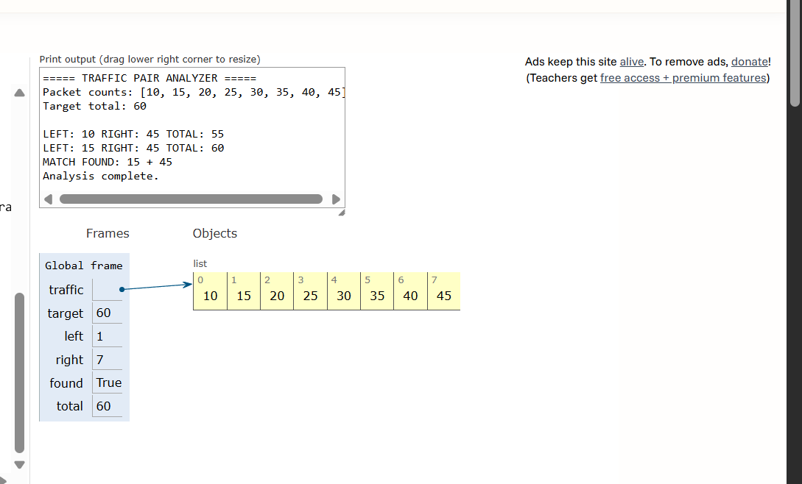
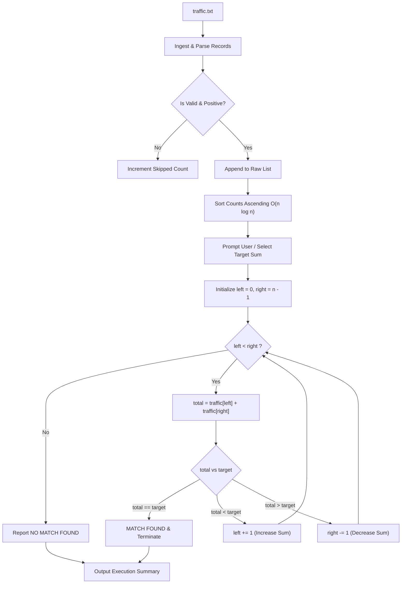

# Day 09 - Traffic Pair Analyzer

> A defensive cybersecurity and data structures project implementing the **Two Pointers** algorithmic technique to detect correlated network traffic volumes and flow volume relationships across sorted flow telemetry records.

[](https://www.python.org/)
[)-blue)](#dsa-concept-two-pointers)
[](#cybersecurity-use-case)
[](#day-09-status)

---

## Overview

In enterprise network monitoring and defensive security operations, incident responders frequently analyze large volumes of network flow telemetry (e.g., NetFlow, IPFIX, Zeek/Bro connection logs) to uncover relationships between disparate traffic sessions. Security analysts often seek pairs of communication flows whose combined metrics—such as packet volume, byte count, or round-trip packet counts—match specific operational thresholds or baseline anomalies.

A naive brute-force examination comparing every network record against every other record requires nested loops ($O(n^2)$ time complexity). In high-throughput network environments processing tens of thousands of connection records per minute, quadratic comparisons quickly cause processing bottlenecks.

This project implements an **explicit, from-scratch Two Pointers algorithm** in Python to locate pairs of flow records whose aggregate packet count equals a specified target. Operating on pre-sorted packet count data, the two-pointer approach converges inward from opposite ends of the collection, eliminating unnecessary comparisons and evaluating candidates in linear time ($O(n)$).

> [!NOTE]
> **Educational Demonstration Notice:** This tool demonstrates the algorithmic mechanics of Two Pointers applied to synthetic network telemetry. It is strictly an educational algorithm demonstration, not a production network intrusion detection or traffic correlation engine. Packet count totals alone do not identify actual malicious behavior.

---

## Cybersecurity Use Case

Correlating traffic metrics across separate network streams is a vital investigative technique in defensive cybersecurity and digital forensics:

- **Data Exfiltration & Multi-Stage Staging:** Attackers often split stolen data across multiple smaller flows or parallel staging egress tunnels to evade threshold-based Data Loss Prevention (DLP) alerts. Correlating pairs of flows whose aggregate packet or byte volume matches known exfiltration payloads aids forensic reconstruction.
- **Stepping-Stone & Relay Detection:** When an adversary bounces traffic through an internal jump host, the inbound ingress flow and outbound egress flow frequently exhibit symmetrical or predictable packet count relationships (e.g., ingress command packets plus outbound response frames).
- **Covert Channel & Beaconing Analysis:** Low-and-slow Command and Control (C2) channels may alternate between fixed message chunks. Identifying paired transmission bursts that align with expected heartbeat packet totals assists threat hunters in isolating covert timing channels.
- **Bandwidth Consumption & Quota Allocation Auditing:** Network security engineers auditing perimeter bandwidth allocation frequently search for complementary flow pairs that saturate allocated egress bandwidth slices.

---

## DSA Concept: Two Pointers

The **Two Pointers** pattern is an efficient algorithmic strategy that uses two index markers to traverse an iterable simultaneously, typically moving toward each other or in coordinated tandem.

### Core Mechanics for the Two-Sum Search

1. **Prerequisite (Sorted Collection):** The data sequence must be sorted in ascending numerical order:
   $$A[0] \le A[1] \le A[2] \le \dots \le A[n-1]$$
2. **Left Pointer (`left = 0`):** Initially references the smallest value at the beginning of the list.
3. **Right Pointer (`right = len(traffic) - 1`):** Initially references the largest value at the end of the list.
4. **Sum Evaluation:** At each iteration, calculate the current sum:
   $$\text{total} = \text{traffic}[\text{left}] + \text{traffic}[\text{right}]$$
5. **Pointer Movement Rules:**
   - **Case 1: $\text{total} == \text{target}$:** A matching pair is identified. Record the pair and terminate.
   - **Case 2: $\text{total} < \text{target}$:** The current total is insufficient. Because the array is sorted, incrementing `left` (`left += 1`) moves to a larger value, increasing the sum toward the target.
   - **Case 3: $\text{total} > \text{target}$:** The current total is excessive. Decrementing `right` (`right -= 1`) moves to a smaller value, decreasing the sum toward the target.
6. **Termination Condition (`left < right`):** The loop continues strictly while `left < right`. If the pointers meet (`left == right`), all possible valid candidate pairs have been exhausted without finding a match. This condition strictly guarantees that an element is **never paired with itself**.

---

## Why Sorted Data Is Required

The Two Pointers technique relies fundamentally on the **monotonicity** of sorted data. 

In an unsorted list, incrementing the left index or decrementing the right index yields unpredictable values—a subsequent element might be smaller, larger, or identical. Under unsorted conditions, discarding half the candidate space would risk skipping the correct complementary pair.

When the array is monotonically non-decreasing:
- If `traffic[left] + traffic[right] > target`, no element to the right of `left` can pair with `traffic[right]` to reach the target, because every such element is greater than or equal to `traffic[left]`. Thus, `traffic[right]` can be safely eliminated by decrementing `right`.
- Conversely, if `traffic[left] + traffic[right] < target`, no element to the left of `right` can pair with `traffic[left]`, allowing `traffic[left]` to be eliminated by incrementing `left`.

Without sorting, every pair must be compared, necessitating $O(n^2)$ brute-force examination.

---

## Algorithm Walkthrough & ASCII Visualization

Consider a sorted packet count sequence: `[10, 15, 20, 25, 30, 35, 40, 45]` with target sum $60$.

### ASCII Pointer Progression

```text
Step 1:
Index:   0    1    2    3    4    5    6    7
Value: [10,  15,  20,  25,  30,  35,  40,  45]
         ↑                                  ↑
       LEFT                               RIGHT
       Sum = 10 + 45 = 55 (< 60)
       Action: Sum too low. Advance LEFT (left += 1).

Step 2:
Index:   0    1    2    3    4    5    6    7
Value: [10,  15,  20,  25,  30,  35,  40,  45]
              ↑                             ↑
            LEFT                          RIGHT
       Sum = 15 + 45 = 60 (== 60)
       Action: MATCH FOUND! Pair is (15, 45).
```

Only **2 comparisons** were required to locate the matching pair among 8 elements, compared to up to 28 comparisons in an exhaustive nested loop.

---

## Python Tutor Visualization

The image below displays the step-by-step memory frame execution trace recorded in Python Tutor, illustrating the global variables (`traffic`, `target = 60`, `left = 1`, `right = 7`, `found = True`, `total = 60`) and the matching output:



---

## Input File Format

The dataset `traffic.txt` stores synthetic flow records using a clean, pipe-delimited schema:

```text
record_id | packet_count
```

### Dataset Properties
- **Positive Integers:** All valid packet counts are strictly positive integers ($> 0$).
- **Repeated Values:** Duplicate packet counts (e.g., identical flow volumes across separate flows) are included to verify duplicate handling.
- **Robustness Testing:** Includes comments (`#`), empty lines, non-numeric values, negative numbers, and delimiter-free rows to ensure defensive parsing.
- **Privacy Safe:** Fully synthetic; contains no real IP addresses, personal data, or proprietary network captures.

### Sample Entries

```text
REC-0001 | 14
REC-0002 | 28
REC-0005 | 50
REC-0006 | 50
REC-0013 | 120
REC-0014 | 120
# Malformed test lines
REC-9991 | NOT_AN_INTEGER
MALFORMED_RECORD_WITHOUT_DELIMITER
REC-9992 | -45
```

---

## Processing Flow



---

## Complexity Analysis

| Phase / Operation | Time Complexity | Space Complexity | Explanation |
| :--- | :--- | :--- | :--- |
| **Record Ingestion & Sanitization** | $O(n)$ | $O(n)$ | Reads $n$ input lines, validates tokens, and builds the raw list. |
| **Ascending Sort (Timsort)** | $O(n \log n)$ | $O(n)$ | Python's native hybrid sort orders values to enable monotonic pointer traversal. |
| **Two Pointers Traversal** | $O(n)$ | $O(1)$ | Each step advances `left` or decrements `right`. Maximum $n - 1$ steps. |
| **Overall End-to-End Pipeline** | $O(n \log n)$ | $O(n)$ | **Dominated by initial sorting** for unsorted input. |

### The Sorting vs. Two Pointers Trade-Off

- **Single Query on Unsorted Data:** If only a single target query is performed on unsorted data, sorting takes $O(n \log n)$ and the scan takes $O(n)$, giving an aggregate time of $O(n \log n)$. This is still substantially faster than naive brute force ($O(n^2)$).
- **Multiple Queries on Pre-Sorted Data:** Once the flow dataset is sorted, any subsequent target query executes in pure **$O(n)$ time** and **$O(1)$ auxiliary space**, requiring no hash table memory overhead.

---

## Project Structure

```text
day-09-traffic-pair-analyzer/
├── main.py            # Explicit Two Pointers algorithm implementation & defensive parser
├── traffic.txt        # Synthetic dataset (120 valid records, duplicate counts, malformed entries)
├── traffic_pair.png   # Python Tutor verified execution memory frame trace
└── README.md          # Complete technical documentation and analysis
```

---

## Installation and Execution

### Prerequisites

- Python 3.8 or higher installed on your system.

### Running Interactive Mode

Launch the script from the project folder:

```bash
python main.py
```

When prompted, press `Enter` to accept the sensible default target (`500`), or enter any positive integer:

```text
Enter target packet sum [default: 500]: 
```

### Running with a Command-Line Argument

You can directly specify a target value as a CLI argument:

```bash
python main.py 500
python main.py 100
python main.py 30
```

---

## Example Execution Output

### Run 1: Matching Pair Found (Default Target = 500)

```text
===== TRAFFIC PAIR ANALYZER =====

Dataset File: D:\cybersecurity-dsa-lab\day-09-traffic-pair-analyzer\traffic.txt
Valid Records Parsed: 120
Skipped Lines (Comments/Malformed/Empty): 10

Target total: 500

LEFT: 14 RIGHT: 1290 TOTAL: 1304
LEFT: 14 RIGHT: 1275 TOTAL: 1289
LEFT: 14 RIGHT: 1260 TOTAL: 1274
... [Pointer adjustments omitted for brevity] ...
LEFT: 42 RIGHT: 450 TOTAL: 492
LEFT: 50 RIGHT: 450 TOTAL: 500
MATCH FOUND: 50 + 450
Analysis complete.

===== SUMMARY =====
Target: 500
Pair Found: True
Matching Values: 50 and 450
Comparisons Evaluated: 77
Active Search Space: 120 records
===================
```

### Run 2: No Matching Pair Found (Target = 30)

```text
===== TRAFFIC PAIR ANALYZER =====

Dataset File: D:\cybersecurity-dsa-lab\day-09-traffic-pair-analyzer\traffic.txt
Valid Records Parsed: 120
Skipped Lines (Comments/Malformed/Empty): 10

Target total: 30

LEFT: 14 RIGHT: 1290 TOTAL: 1304
LEFT: 14 RIGHT: 1275 TOTAL: 1289
... [Right pointer decrements continuously until left == right] ...
LEFT: 14 RIGHT: 28 TOTAL: 42
NO MATCH FOUND: No pair of distinct packet counts sums to target 30.
Analysis complete.

===== SUMMARY =====
Target: 30
Pair Found: False
Comparisons Evaluated: 119
Active Search Space: 120 records
===================
```

---

## Tests Performed

A comprehensive suite of edge-case tests was conducted to verify algorithmic correctness and defensive parsing resilience:

1. **Valid Dataset Parsing:** Correctly parsed 120 valid records from `traffic.txt`.
2. **Malformed Record Resilience:** Gracefully skipped 10 non-standard lines (comments, blank lines, non-integers, negative numbers, and delimiter-less records) without raising unhandled exceptions.
3. **Empty Dataset Handling:** Handled empty list input (`[]`) safely, returning `(False, None, 0)` with an informative warning message.
4. **Single-Element / Insufficient Input:** Handled list of length 1 safely; strictly prevented pairing an element with itself.
5. **No Self-Pairing Verification:** Tested input `[10, 50, 80]` with target `100`. Verified that `50` was **never paired with itself** ($50 + 50 = 100$ rejected because only one 50 was present).
6. **Duplicate Packet Counts:** Tested input `[20, 50, 50, 85]` with target `100`. Verified that distinct duplicate records at different indices matched correctly ($50 + 50 = 100$).
7. **Python Tutor Consistency:** Tested `[10, 15, 20, 25, 30, 35, 40, 45]` with target `60`. Confirmed exact match with `traffic_pair.png` trace (`15 + 45 = 60` in 2 steps).
8. **Invalid User Input Handling:** Tested non-numeric string input (`"invalid_input"`), negative numbers, and `EOFError` during interactive prompting, confirming fallback to default target without crashing.

---

## Limitations

- **Loss of Temporal Sequence:** Sorting the dataset groups records by packet count rather than chronologically. While optimal for value correlation, it abstracts away connection timestamps and flow arrival ordering.
- **Single Pair Return:** The basic algorithm stops upon finding the first valid matching pair. Identifying all unique matching pairs requires continuing the scan while properly advancing pointers past duplicate values.
- **Univariate Metric:** The model correlates packet counts in isolation; production correlation typically evaluates multi-dimensional attributes (byte counts, source/destination subnets, duration, and protocol).

---

## Future Improvements

- **All-Pairs Enumeration:** Extend the two-pointer loop to discover and report all unique pairs that sum to the target value while skipping duplicate pairings.
- **Multi-Metric Two-Pointer Analysis:** Integrate joint constraints such as packet volume and flow duration (e.g., finding flows that match a combined bandwidth and duration threshold).
- **Sliding Window Time Bounding:** Restrict pair candidates to flows occurring within a bounded rolling time window ($\Delta t \le 60\text{s}$) to maintain temporal correlation.

---

## Security Disclaimer

> [!CAUTION]
> This software is developed solely for educational and training purposes as part of a 30-day Cybersecurity and Data Structures & Algorithms sprint. It demonstrates the behavior of the Two Pointers algorithm on numerical records. In production environments, network flow anomaly detection requires multi-layered heuristic analysis, contextual threat intelligence feeds, protocol inspection, and machine learning models. Packet count sums alone do not indicate malicious intent.

---

## Day 09 Status

- [x] Project created strictly under `day-09-traffic-pair-analyzer/`
- [x] Synthetic dataset created in `traffic.txt` (120 valid records, duplicate counts, malformed entries)
- [x] Explicit Two Pointers algorithm implemented in `main.py`
- [x] User input prompt with sensible default and crash-proof input validation
- [x] Defensive file parsing with malformed record reporting (120 parsed, 10 skipped)
- [x] Verified prevention of self-pairing (`left < right`)
- [x] Embedded genuine Python Tutor execution screenshot (`traffic_pair.png`)
- [x] Comprehensive technical documentation with complexity analysis and ASCII diagrams
- [x] Days 01–08 untouched and uncommitted
