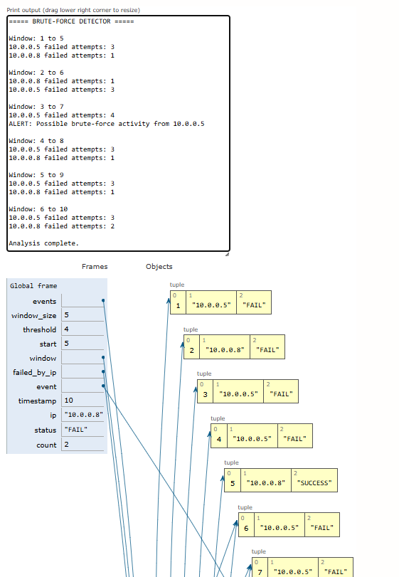

# Day 10 - Brute-Force Detector

> A defensive cybersecurity and data structures project implementing the **Sliding Window** algorithmic technique to detect time-window authentication attacks (brute-force, credential stuffing, and password spraying) across chronological authentication telemetry.

[](https://www.python.org/)
[)-blue)](#dsa-concept-sliding-window)
[](#cybersecurity-use-case)
[](#day-10-status)

---

## Overview

In modern enterprise security operations centers (SOC) and identity management systems, authentication telemetry is one of the highest-volume event streams monitored by defensive analysts. Adversaries frequently utilize automated attack tools (e.g., Hydra, Medusa, Burp Suite Intruder) to perform brute-force credential guessing, password spraying against enterprise directories, or credential stuffing using compromised credential dumps.

A naive detection implementation would scan the entire log dataset repeatedly for each evaluation window ($O(n \cdot k)$ or $O(n^2)$ time complexity), or treat a fixed count of events as a proxy for time (e.g., treating 5 arbitrary events as 5 minutes). In high-throughput corporate identity gateways processing tens of thousands of authentication events every second, naive rescanning leads to severe CPU bottlenecks and delayed alert pipelines.

This project implements an **enterprise-grade, timestamp-based Sliding Window algorithm** in Python using a monotonic two-pointer approach ($O(n)$ time complexity). By maintaining dynamic per-IP failure counters as the temporal window moves forward across chronologically sorted authentication logs, the analyzer identifies suspicious source IPs that exceed failure thresholds within a configured time duration (e.g., 5 minutes) without re-evaluating past events.

> [!NOTE]
> **Educational & Defensive Scope:** This detector is built for defensive analysis, security education, and algorithmic demonstration on synthetic logs. It does not perform network packet inspection, active IP blocking, or firewall modifications.

---

## Cybersecurity Use Case

Authentication boundary monitoring is a fundamental control within zero-trust architectures and SOC defensive monitoring:

- **Brute-Force Detection:** Automated attack tools submit hundreds of password guesses against a single target account within a short timeframe. Detecting rapid failed attempts from a single source IP allows defensive analysts to trigger targeted challenge prompts (MFA) or account defenses.
- **Credential Stuffing Mitigation:** Adversaries leverage botnets to test credential lists across employee login portals. Tracking temporal failure clusters helps distinguish distributed bot activity from routine employee authentication.
- **Differentiating User Error from Malicious Activity:** Legitimate human users frequently mistype their passwords once or twice before authenticating successfully. Fixed static counts without time boundaries falsely penalize legitimate employees who accumulate 5 mistyped passwords over several weeks. A sliding time window isolates high-frequency failure bursts from normal baseline human error.
- **Defense-in-Depth Telemetry:** Feeding sliding-window alert outputs into a SIEM (Security Information and Event Management) platform provides SOC responders with high-fidelity indicators to correlate with subsequent lateral movement, endpoint alerts, or suspicious token issuance.

---

## DSA Concept: Sliding Window

The **Sliding Window** pattern is an algorithmic technique used to track contiguous segments, subsets, or time intervals within a sequence without repeatedly scanning sub-elements.

```text
Time Line:  [t0]   [t1]   [t2]   [t3]   [t4]   [t5]   [t6]   [t7]   ...
            [ <-------- Active Time Window W --------> ]
            ^                                          ^
          LEFT                                       RIGHT
            (advances to evict expired events)         (advances to ingest new events)
```

### Monotonic Two-Pointer Mechanics

1. **Chronological Stream:** Events are arranged in chronological order by timestamp:
   $$t_0 \le t_1 \le t_2 \le \dots \le t_{n-1}$$
2. **Right Boundary (`right`):** Iterates sequentially across events from index `0` to `n - 1`. Each incoming event at `right` expands the active window to include timestamp $t_{\text{right}}$.
3. **Left Boundary (`left`):** Represents the trailing edge of the active window. Whenever the difference between the current event timestamp and the trailing event timestamp exceeds the window duration:
   $$t_{\text{right}} - t_{\text{left}} > W$$
   the event at `left` is evicted from the active window state, and `left` advances forward (`left += 1`).
4. **Per-IP State Tracking:**
   - A hash map `active_fails[ip]` tracks the exact number of failed attempts currently within $[t_{\text{left}}, t_{\text{right}}]$.
   - When an event with status `FAIL` enters at `right`, `active_fails[ip]` is incremented.
   - When an event with status `FAIL` exits at `left`, `active_fails[ip]` is decremented (and cleaned up when zero).
   - Successful logins (`SUCCESS`) never increment failure counters.
5. **Threshold Evaluation:** When `active_fails[ip] >= threshold`, an alert is fired with the specific failure count and burst time range.

---

## Why Time Windows Matter

In realistic authentication systems, **time-based windows** are fundamentally different from **event-count-based windows**:

| Criterion | Event-Count Window (Naive) | Timestamp-Based Window (Realistic) |
| :--- | :--- | :--- |
| **Window Definition** | Fixed $k$ consecutive events (e.g., 5 events) | Fixed time span $W$ (e.g., 300 seconds / 5 minutes) |
| **Temporal Meaning** | 5 events could span 2 seconds or 2 weeks | Window always represents the exact specified physical time slice |
| **Low-Traffic Periods** | 5 failures across 3 weeks trigger an alert | 5 failures spread across 3 weeks are safely ignored |
| **High-Traffic Periods** | Rapid attacks diluted across concurrent users | Ingests all events in the interval regardless of volume |
| **False-Positive Rate** | Extremely high for normal human mistakes | Low; accurately isolates burst activity |

---

## Input Format

The telemetry dataset `auth_events.txt` uses a pipe-delimited schema:

```text
timestamp | source_ip | status
```

### Field Definitions

1. `timestamp`: ISO 8601 formatted UTC timestamp (`YYYY-MM-DDTHH:MM:SS`).
2. `source_ip`: Source IPv4 address. Validated against RFC 1918 private subnets (`10.0.0.0/8`, `172.16.0.0/12`, `192.168.0.0/16`) or loopback.
3. `status`: Authentication outcome, strictly `FAIL` or `SUCCESS`.

### Sample Entries

```text
2026-10-19T08:00:18 | 10.0.0.20 | SUCCESS
2026-10-19T08:10:13 | 10.0.0.42 | FAIL
2026-10-19T08:10:33 | 10.0.0.42 | SUCCESS
2026-10-19T08:10:56 | 10.0.0.15 | FAIL
2026-10-19T08:11:17 | 10.0.0.15 | FAIL
```

### Defensive Error Handling

The parser rejects and safely skips:
- Blank and whitespace-only lines
- Comment headers beginning with `#`
- Rows with missing delimiters or incorrect column counts
- Malformed timestamps (e.g., non-existent dates, non-ISO formats)
- Invalid or non-private IP addresses (e.g., out-of-range octets like `999.300.1.1` or non-numeric strings)
- Unrecognized authentication statuses (e.g., `TIMEOUT`, `UNKNOWN`, `PENDING`)

---

## Detection Logic

```text
[Incoming Auth Record]
         │
         ▼
[Validate Delimiter, Timestamp, IP, Status] ──► (Malformed) ──► Log Reason & Skip
         │
     (Valid)
         ▼
[Sliding Window Evaluation]
  1. Cutoff = Current_Timestamp - Window_Duration
  2. While Left_Event_Timestamp < Cutoff:
       - If Left_Event was 'FAIL', decrement IP failure counter
       - Advance Left Pointer (left += 1)
  3. If Current_Event is 'FAIL':
       - Increment IP failure counter
       - If IP failure counter >= Threshold:
           ──► TRIGGER ALERT / LOG INCIDENT
  4. Advance Right Pointer (right += 1)
```

---

## Configuration

The detector provides configurable parameters accessible through function arguments or CLI flags:

| Parameter | CLI Flag | Default | Description |
| :--- | :--- | :--- | :--- |
| **Telemetry File** | `-f`, `--file` | `auth_events.txt` | Path to the authentication log file |
| **Window Duration**| `-w`, `--window` | `300` | Window size in seconds ($300\text{s} = 5.0\text{ mins}$) |
| **Failure Threshold** | `-t`, `--threshold` | `5` | Failed attempts required within window to alert |
| **Verification Test** | `--test` | `False` | Executes automated synthetic test verification suite |
| **Quiet Mode** | `-q`, `--quiet` | `False` | Suppresses streaming logs, displaying report only |

---

## Processing Flow & ASCII Trace

Consider an evaluation with `window = 300s` and `threshold = 4` failures:

```text
Step 1: 08:10:00 | 10.0.0.15 | FAIL  ──► Window: [08:10:00 -> 08:10:00] | Count: 1
Step 2: 08:10:30 | 10.0.0.15 | FAIL  ──► Window: [08:10:00 -> 08:10:30] | Count: 2
Step 3: 08:11:00 | 10.0.0.15 | FAIL  ──► Window: [08:10:00 -> 08:11:00] | Count: 3
Step 4: 08:11:45 | 10.0.0.15 | FAIL  ──► Window: [08:10:00 -> 08:11:45] | Count: 4
        >>> [ALERT TRIGGERED] Source: 10.0.0.15 reached 4/4 failures in 105.0s <<<
Step 5: 08:17:00 | 10.0.0.15 | FAIL  ──► Cutoff is 08:12:00.
        Left pointer evicts steps 1, 2, 3, 4 (all prior to 08:12:00).
        Count drops back to 1. No spurious alert fired.
```

---

## Example Input and Actual Execution Output

### Sample Input Telemetry (`auth_events.txt`)

```text
2026-10-19T08:09:58 | 172.16.0.6 | SUCCESS
2026-10-19T08:10:13 | 10.0.0.42 | FAIL
2026-10-19T08:10:33 | 10.0.0.42 | SUCCESS
# --- Morning Authentication Audit Log Snapshot ---
2026-10-19T08:10:56 | 10.0.0.15 | FAIL
2026-10-19T08:11:17 | 10.0.0.15 | FAIL
2026-10-19T08:11:36 | 10.0.0.15 | FAIL
2026-10-19T08:11:54 | 10.0.0.15 | FAIL
2026-10-19T08:12:15 | 10.0.0.15 | FAIL
2026-10-19T08:12:37 | 10.0.0.15 | FAIL
2026-10-19T08:12:56 | 10.0.0.15 | FAIL
2026-10-19T08:13:06 | 999.300.1.1 | FAIL
```

### Actual Terminal Execution Output (`python main.py`)

```text
===== STARTING BRUTE-FORCE DETECTOR ANALYSIS =====
Target Telemetry File : D:\cybersecurity-dsa-lab\day-10-brute-force-detector\auth_events.txt
Sliding Window Size   : 300 seconds (5.0 minutes)
Failure Alert Cutoff  : 5 failed logins

[*] Processing events chronologically through sliding window...
[ALERT TRIGGERED] Source: 10.0.0.15       | Failed Attempts: 5/5 | Window: 08:10:56 -> 08:12:15 (79.0s)
  |-- [ESCALATION] Source: 10.0.0.15       | Consecutive Failures: 6 | Time: 08:12:37
  |-- [ESCALATION] Source: 10.0.0.15       | Consecutive Failures: 7 | Time: 08:12:56
[ALERT TRIGGERED] Source: 192.168.1.50    | Failed Attempts: 5/5 | Window: 08:36:36 -> 08:37:49 (73.0s)
  |-- [ESCALATION] Source: 192.168.1.50    | Consecutive Failures: 6 | Time: 08:38:09
[ALERT TRIGGERED] Source: 172.16.0.99     | Failed Attempts: 5/5 | Window: 09:01:33 -> 09:03:18 (105.0s)
  |-- [ESCALATION] Source: 172.16.0.99     | Consecutive Failures: 6 | Time: 09:03:40

==============================================================================
           DEFENSIVE SECURITY OPERATIONS - BRUTE-FORCE DETECTOR           
==============================================================================

[+] CONFIGURATION PARAMETERS:
    - Sliding Window Duration : 300 seconds (5.0 minutes)
    - Failure Alert Threshold : 5 failed attempts
    - Detection Algorithm     : Monotonic Two-Pointer Sliding Window (O(n))

[+] TELEMETRY INGESTION SUMMARY:
    - Total Lines Read        : 166
    - Valid Chronological Evts: 156
    - Skipped / Corrupted Rows: 10

[!] SKIPPED RECORDS BREAKDOWN (Defensive Error Recovery):
    - Line  31 | Reason: Comment line                     | Content: '# --- Morning Authentication Audit ...'
    - Line  39 | Reason: Invalid or non-private IPv4 address: '999.300.1.1' | Content: '2026-10-19T08:13:06 | 999.300.1.1 |...'
    - Line  40 | Reason: Empty line                       | Content: ''
    - Line  77 | Reason: Missing pipe delimiter '|'       | Content: '2026-10-19T08:35:27 10.0.0.5 FAIL'
    - Line  79 | Reason: Invalid or non-private IPv4 address: '10.0.0.abc' | Content: '2026-10-19T08:36:12 | 10.0.0.abc | ...'
    - ... and 5 additional skipped lines.

[+] DETECTION RESULTS & INCIDENT ANALYSIS:
    [!] High-priority alerts generated: 7 alert events across 3 suspicious IPs.

    SOURCE IP        PEAK FAILS   FIRST ALERT          BURST SPAN     SEVERITY
    ------------------------------------------------------------------------
    10.0.0.15        7 / 5        2026-10-19 08:12:15  79.0s          CRITICAL
    192.168.1.50     6 / 5        2026-10-19 08:37:49  73.0s          HIGH
    172.16.0.99      6 / 5        2026-10-19 09:03:18  105.0s         HIGH

[+] SECURITY ADVISORY:
    - Repeated authentication failures provide a strong detection signal of automated
      credential attacks, but do not constitute forensic proof of compromise.
    - Recommended Response: Validate against external threat intelligence, correlate with
      account lockout telemetry, and apply MFA step-up rather than auto-banning internal IPs.
==============================================================================
```

---

## Python Tutor Visualization

The image below illustrates the step-by-step memory frame execution trace recorded during the Python Tutor simulation, displaying active variables (`events`, `window_size = 5`, `threshold = 4`, `failed_by_ip = {'10.0.0.5': 3, '10.0.0.8': 2}`) and the corresponding alert generation:



---

## Complexity Analysis

### Time Complexity

- **Input Validation & Parsing:** Parsing $n$ lines requires validating timestamps and IP addresses, running in $O(n)$ time.
- **Chronological Verification/Sorting:** The implementation verifies chronological ordering. For pre-sorted logs, Python's Timsort operates in linear time:
  $$\mathcal{O}(n)$$
  If unsorted logs were provided, sorting would require $\mathcal{O}(n \log n)$.
- **Two-Pointer Window Scan:**
  - The `right` pointer moves sequentially from `0` to `n - 1`, visiting each event exactly once ($n$ iterations).
  - The `left` pointer moves monotonically forward from `0` to `n`. Over the entire program execution, `left` increments at most $n$ times across all inner while loop evaluations.
  - Adding an event to `active_fails` and appending to the failure deque takes $\mathcal{O}(1)$ amortized time.
  - Evicting an expired event from `active_fails` and popping from the deque takes $\mathcal{O}(1)$ amortized time.
  - Overall sliding window time complexity is strictly:
  $$\mathcal{O}(n)$$
- **Total Time Complexity:** $\mathcal{O}(n)$ on chronologically ordered input.

### Space Complexity

- **Event Storage:** Storing $n$ validated `AuthEvent` objects takes $\mathcal{O}(n)$ space.
- **Sliding Window State:**
  - `active_fails` hash map stores at most $u$ entries, where $u$ is the number of unique IP addresses with active failures in the window ($u \le n$).
  - `fail_deques` stores failure timestamps for active window events ($w \le n$).
- **Alert History:** Stores $a$ alert instances ($a \le n$).
- **Total Space Complexity:** $\mathcal{O}(n + u)$ where $u \le n$.

---

## Project Structure

```text
day-10-brute-force-detector/
├── main.py              # Core sliding-window detector & CLI entry point
├── auth_events.txt      # 166-line synthetic authentication telemetry dataset
├── brute_force.png      # Python Tutor memory frame visualization
└── README.md            # Comprehensive architecture & operational documentation
```

---

## How to Run

### 1. Default Detection Run

Run the detector on the default synthetic telemetry dataset:

```bash
python main.py
```

### 2. Custom Window and Threshold Settings

Analyze with a tighter 2-minute window (120s) and a lower threshold of 3 failures:

```bash
python main.py --window 120 --threshold 3
```

### 3. Automated Synthetic Verification Test Suite

Run the automated verification suite to programmatically test all 7 validation scenarios:

```bash
python main.py --test
```

### 4. Custom Telemetry Log File

Run the detector against a custom log file:

```bash
python main.py --file path/to/custom_auth.log
```

---

## Tests Performed

The built-in verification suite (`python main.py --test`) programmatically executes and validates deterministic synthetic test cases:

```text
=================================================================
            RUNNING AUTOMATED VERIFICATION TESTS            
=================================================================
[PASS] Test 1: Normal login activity below threshold produces 0 alerts.
[PASS] Test 2: Repeated failed attempts within window trigger alert.
[PASS] Test 3: Failures spread beyond window duration are not combined.
[PASS] Test 4: Successful logins are not counted as failures.
[PASS] Test 5: Malformed records are safely skipped with correct counts.
[PASS] Test 6: Empty input handles gracefully without crashes.
[PASS] Test 7: Configurable threshold and window duration operate as documented.
=================================================================
       ALL 7/7 VERIFICATION TESTS PASSED SUCCESSFULLY!       
=================================================================
```

### Test Details

1. **Sub-Threshold Normal Traffic:** 3 failed logins from `10.0.0.1` evaluated against threshold 5 produced 0 alerts.
2. **Windowed Brute-Force Burst:** 5 rapid failures from `10.0.0.2` within 80 seconds correctly triggered an alert.
3. **Spread-Out Failures:** 5 failures from `172.16.0.25` spaced 400 seconds apart across a 300-second window correctly evicted older failures, resulting in 0 false alerts.
4. **Successful Login Independence:** 2 failures interleaved with 6 successful logins for `10.0.0.4` verified that successes do not contribute to failure thresholds.
5. **Defensive Log Parsing:** Verified that 6 malformed records (missing delimiters, invalid IP octets, illegal statuses, bad dates, empty lines) were skipped without interrupting execution.
6. **Zero-Event Edge Case:** Evaluated an empty event collection to confirm zero crashes and proper reporting.
7. **Parameter Sensitivity:** Verified that adjusting window sizes (100s vs 300s) and thresholds (4 vs 5) correctly altered alert decisions.

---

## Limitations

- **Single-Source Assumption:** Tracks attacks originating from a single source IP address. Distributed brute-force attacks (where hundreds of distinct bot IPs test a single username once each) will not trigger per-IP thresholds.
- **Memory Consumption in Long Windows:** Setting window durations to several days in high-throughput environments would keep millions of events in memory.
- **Chronological Requirement:** Assumes log events arrive in chronological order. In distributed architectures where log aggregators induce out-of-order jitter, events must pass through a buffer or sorting stage before window ingestion.
- **Target Account Agnostic:** Tracks failures strictly by source IP rather than by target username. An attacker spraying passwords across 50 distinct usernames from one IP will trigger the threshold, but targeted attacks against one username from multiple IPs require multi-dimensional windowing.

---

## Future Improvements

- **Multi-Dimensional Sliding Windows:** Extend the sliding window state to track `(source_ip, target_username)` and `(target_username)` simultaneously to detect both brute-force and password-spraying campaigns.
- **Distributed Stream Processing:** Implement sliding window aggregation over Apache Kafka or Redis Sorted Sets (`ZADD` / `ZREMRANGEBYSCORE`) for distributed, real-time ingestion.
- **Automated IP Reputation Lookups:** Enrich flagged IP addresses with external threat intelligence APIs (e.g., AbuseIPDB, VirusTotal, AlienVault OTX).
- **Dynamic Adaptive Baselines:** Automatically calculate thresholds per subnet using moving standard deviations instead of static failure counts.

---

## Security Disclaimer

> [!WARNING]
> **Authentication Detection Advisory:** Repeated authentication failures serve as an initial detection indicator, **not forensic proof of compromise**. Legitimate conditions such as expired Kerberos tickets, misconfigured background sync clients, and human password recall errors regularly produce repeated failures. Never execute automatic firewall IP bans without secondary corroboration or MFA challenge workflows.
